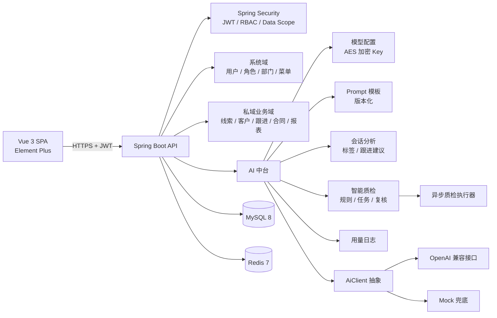
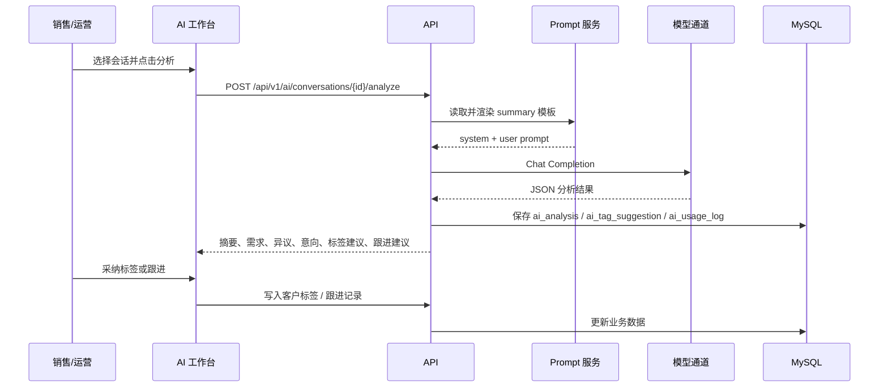

# 木心 MUXIN · AI 私域运营系统

**一套以 AI 中台为核心的私域客户运营系统。** 后端提供客户、线索、订单、权限与经营分析能力，AI 中台负责会话理解、客户情报提炼、标签与跟进建议、会话质检和模型治理。

> 架构设计、后端与前端实现：**icysnowrhyme**
>
> 当前版本：`1.0.0` · 许可协议：Apache-2.0（前端目录为 MIT）

---

## 1. 项目定位

私域运营系统真正难的不是“把客户录进去”，而是让一线销售在大量会话里快速抓住重点、让管理者用统一标准检查服务质量，并让 AI 能力可以被配置、被追踪、被人复核。

MUXIN 的设计目标是把这件事拆成三层：

1. **业务层**：线索、客户、跟进、订单、标签、组织与权限，构成私域运营的数据底座。
2. **AI 中台**：模型接入、Prompt 管理、会话分析、标签建议、跟进建议、质检任务、用量统计，作为独立能力层服务业务。
3. **人机协同层**：AI 输出不直接改业务数据，标签、跟进和质检结论都需要人工采纳或复核。

项目不是把模型调用散落在各个 Controller 里，而是把 AI 当作一套可治理的基础设施来设计：模型可切换、Prompt 可版本化、调用可计量、结果可追溯、失败可降级。

## 2. 核心能力

| 能力 | 说明 |
| --- | --- |
| 会话智能分析 | 从销售会话中提取摘要、需求、异议、预算、决策人、双方承诺、下一步动作、情绪与意向等级 |
| 客户标签建议 | 根据会话证据推荐标签，人工采纳后写入客户标签 |
| 跟进建议 | 生成下一步跟进动作，人工确认后写入跟进记录 |
| 智能质检 | 按可配置规则异步质检会话，输出违规命中、严重级别、证据原文与判定理由 |
| 质检复核 | 支持“确认违规 / 误报”人工复核，并同步统计概览 |
| Prompt 版本化 | 摘要与质检模板在线编辑，保存自动递增版本，便于回溯 |
| 模型治理 | OpenAI 兼容接口、Mock 兜底、API Key 加密存储、调用用量统计 |
| 私域业务骨架 | 线索、客户、跟进、订单（合同）、经营报表、组织与角色权限 |
| 细粒度权限 | AI 设置、模型测试、质检规则维护均通过独立权限点控制 |

## 3. 系统架构



### 3.1 分层职责

| 层 | 职责 | 关键实现 |
| --- | --- | --- |
| 交互层 | 登录、导航、业务页面、AI 工作台 | Vue 3、Pinia、Vue Router、Element Plus |
| 接口层 | 参数校验、统一响应、鉴权、日志 | Spring MVC、Spring Security、SpringDoc |
| 业务域 | 线索、客户、跟进、合同、报表、组织权限 | MyBatis-Plus、领域服务、数据范围 |
| AI 中台 | 模型接入、Prompt、分析、质检、用量 | `AiClient`、异步执行器、版本化模板 |
| 基础设施 | 数据库、缓存、配置、加密 | MySQL 8、Redis 7、Druid、AES |

### 3.2 AI 中台设计

AI 中台不是单一 Service，而是一组边界清晰的组件：

- **`AiClient`**：模型调用抽象，屏蔽具体厂商差异。
- **`OpenAiCompatibleClient`**：通过标准 Chat Completions 协议接入任意兼容服务。
- **`MockAiClient`**：无真实 Key 或调用失败时的确定性兜底，保证演示与联调可重复。
- **`AiModelConfigService`**：模型配置、默认模型、连通性测试、API Key 加密与脱敏。
- **`AiPromptTemplateService`**：摘要与质检 Prompt 的读取、渲染和版本递增。
- **`AiConversationService`**：会话分析、标签建议、跟进建议，以及采纳后的业务写入。
- **`AiQualityRuleService` / 质检任务链路**：规则维护、异步任务、结果落库与人工复核。
- **`AiUsageLog`**：记录功能、模型、耗时、Token 与调用结果，为成本治理提供依据。

### 3.3 一次会话分析的链路



### 3.4 为什么 AI 结果不直接落业务表

AI 输出可能不稳定，直接写客户标签或跟进记录会污染业务数据。项目采用 **human-in-the-loop**：

- 分析结果先进入 `ai_analysis`、`ai_tag_suggestion`；
- 销售确认后再写入客户标签；
- 跟进建议确认后才生成跟进记录；
- 质检结果必须经过“确认违规 / 误报”复核，统计才计入最终口径。

这让 AI 成为“可审计的助手”，而不是不可控的自动写入器。

## 4. 功能地图

| 模块 | 页面/接口 | 说明 |
| --- | --- | --- |
| AI 工作台 | `/ai/workbench` | 会话列表、分析结果、标签建议、跟进建议与采纳 |
| 智能质检 | `/ai/quality` | 任务创建、异步执行、命中证据、人工复核、概览统计 |
| AI 设置 | `/ai/settings` | 模型配置、连通性测试、用量统计、Prompt 模板 |
| 线索管理 | `/crm/clues/*` | 创建、待办、管理、公海、原始进线等 |
| 客户管理 | `/crm/customer/*` | 客户档案、标签、跟进、详情 |
| 订单管理 | `/crm/order/*` | 订单（合同）列表、审核与状态流转 |
| 经营报表 | `/report/*` | 员工业绩、员工绩效与经营分析 |
| 组织权限 | `/crm/system/*` | 部门、角色、用户与系统配置 |
| 数据互通 | `/gateway/*` | 云店、云仓、商品与平台线索入口 |

## 5. 技术栈

| 层次 | 技术 |
| --- | --- |
| 后端 | Java 17、Spring Boot 4.0.1、Spring Security、MyBatis-Plus 3.5、Druid |
| 数据库 | MySQL 8（`utf8mb4`） |
| 缓存 | Redis 7 |
| 认证 | JWT、图形验证码、角色权限、数据范围 |
| AI 接入 | OpenAI 兼容 Chat Completions、Mock 兜底、AES 加密 Key |
| 前端 | Vue 3.5、TypeScript、Vite 8、Element Plus 2.14、Pinia、ECharts |
| 接口文档 | SpringDoc / OpenAPI 3 |
| 部署 | Docker Compose、Nginx、systemd |

## 6. 目录结构

```text
muxin-scrm/
├── backend/
│   ├── src/main/java/com/muxin/scrm/
│   │   ├── module/ai/             # 模型、Prompt、分析、质检、用量
│   │   ├── module/scrm/           # 客户、跟进、合同、标签等业务域
│   │   ├── module/report/         # 经营报表聚合
│   │   ├── system/                # 用户、角色、部门、菜单、日志
│   │   ├── security/              # JWT、权限、登录态
│   │   └── config/                # Web、MyBatis、Redis、OpenAPI
│   └── src/main/resources/
│       ├── mapper/                # MyBatis XML
│       ├── templates/codegen/     # 代码生成模板
│       └── application*.yml       # 环境配置
├── frontend/
│   └── src/
│       ├── api/ai/                # AI 接口
│       ├── api/analytics/         # 报表与组织数据
│       ├── api/scrm/              # 客户、标签、合同
│       ├── navigation/            # 导航、公告、业务常量
│       ├── router/                # 路由与访问守卫
│       ├── views/ai/              # AI 工作台、质检、设置
│       ├── views/workspace/       # 线索、客户、订单、报表、组织
│       └── styles/theme.scss      # 设计令牌
├── sql/
│   ├── muxin_scrm.sql             # 业务库初始化
│   └── muxin_ai.sql               # AI 表与演示数据
├── docs/                          # 架构、接口、部署、设计说明
├── docker-compose.yml             # MySQL + Redis
├── .env.example                   # 环境变量模板
└── README.md
```

> 说明：`views/workspace` 是私域业务工作区，`views/ai` 是 AI 能力页面；两者共享 `api/` 与 `navigation/` 的公共能力，避免页面之间直接耦合。

## 7. 快速开始

### 7.1 环境要求

- JDK 17
- Maven 3.9+
- Node.js `^20.19.0` 或 `>=22.12.0`
- pnpm 9+
- Docker Desktop（用于 MySQL 与 Redis）

### 7.2 初始化配置

```bash
cp .env.example .env
# 修改 .env 中的数据库、Redis、JWT 与 AI 加密口令
set -a && . ./.env && set +a
```

关键变量：

| 变量 | 说明 |
| --- | --- |
| `MYSQL_ROOT_PASSWORD` | MySQL root 密码 |
| `DB_NAME` | 默认 `muxin_scrm` |
| `DB_PASSWORD` | 必须与 `MYSQL_ROOT_PASSWORD` 一致 |
| `REDIS_PASSWORD` | Redis 密码 |
| `JWT_SECRET` | JWT 签名密钥，至少 32 位随机字符串 |
| `AI_ENCRYPT_KEY` | 模型 API Key 的 AES 加密口令 |
| `AI_FALLBACK_MOCK` | 模型调用失败时是否回退 Mock |

### 7.3 启动依赖

```bash
docker compose up -d
```

首次在空数据卷启动时，MySQL 会自动执行：

- `sql/muxin_scrm.sql`：系统表、私域业务表、演示账号与虚构业务数据；
- `sql/muxin_ai.sql`：AI 中台表、权限点、模型与 Prompt 演示数据。

如果 `volumes/mysql` 已有数据，初始化脚本不会重复执行，需要手动导入：

```bash
mysql -h127.0.0.1 -P3308 -uroot -p muxin_scrm < sql/muxin_scrm.sql
mysql -h127.0.0.1 -P3308 -uroot -p muxin_scrm < sql/muxin_ai.sql
```

### 7.4 启动后端

```bash
cd backend
mvn spring-boot:run
```

或构建后运行：

```bash
mvn -DskipTests package
java -jar target/muxin-scrm.jar
```

默认端口：`8001`。接口文档：<http://localhost:8001/swagger-ui/index.html>。

### 7.5 启动前端

```bash
cd frontend
pnpm install
pnpm dev
```

默认访问：<http://localhost:3001>。

### 7.6 演示账号

| 账号 | 密码 | 角色 |
| --- | --- | --- |
| `admin` | `123456` | 管理员 |
| `dept_manager` | `123456` | 部门主管 |
| `dept_member` | `123456` | 部门成员 |

演示账号仅用于本地体验，部署到公网前必须修改密码并替换全部密钥。

## 8. AI 模型配置

进入 **AI 设置** 页面，填写：

- `provider`：供应商标识（仅用于展示与路由）
- `baseUrl`：OpenAI 兼容接口地址，例如 `https://api.openai.com/v1`
- `model`：模型名
- `apiKey`：访问密钥（保存后只显示掩码）
- `temperature` / `maxTokens`：生成参数
- `enabled` / `isDefault`：启用状态与默认模型

未配置真实模型或调用失败时，系统可回退到 Mock 通道，保证演示、联调和浏览器验收不中断。真实模型返回必须符合约定 JSON 结构，否则会进入失败处理与用量日志。

Prompt 模板中的占位符：

- 摘要：`{customer}`、`{conversation}`
- 质检：`{rules}`、`{conversation}`

保存模板会自动递增版本号，避免“改了 Prompt 却无法回溯”。

## 9. 数据模型

### 9.1 AI 中台

| 表 | 作用 |
| --- | --- |
| `ai_model_config` | 模型配置、加密 Key、默认模型 |
| `ai_prompt_template` | 摘要/质检 Prompt 与版本 |
| `ai_analysis` | 会话分析结果 |
| `ai_tag_suggestion` | 标签建议与证据 |
| `ai_quality_rule` | 质检规则、判定说明、严重级别 |
| `ai_quality_task` | 质检任务与执行状态 |
| `ai_quality_result` | 命中结果、证据、复核结论 |
| `ai_usage_log` | 调用功能、模型、耗时、Token |

### 9.2 业务域

`biz_customer`、`biz_follow_up`、`biz_contract`、`biz_customer_tag` 等表承载客户、跟进、合同与标签；`sys_user`、`sys_role`、`sys_menu`、`sys_dept` 提供组织与权限。

AI 结果与业务数据通过“建议 → 人工采纳”解耦，避免模型输出直接污染客户档案。

## 10. 权限与安全

### 10.1 权限模型

- 登录后由 JWT 携带用户身份；
- 接口通过 `@PreAuthorize("@ss.hasPerm('...')")` 校验权限点；
- 权限点来自 `sys_menu.perm`，经角色绑定后缓存在 Redis；
- `ROOT` 角色默认放行；
- 数据范围按角色控制：管理员/部门主管可查看全量，普通成员默认只看本人数据。

AI 相关权限点：

| 权限点 | 说明 |
| --- | --- |
| `ai:config:list` | 查看模型配置 |
| `ai:config:update` | 保存模型配置 |
| `ai:config:test` | 连通性测试 |
| `ai:quality:rule` | 质检规则维护 |

### 10.2 安全边界

- `.env`、证书、真实 API Key 不进入仓库；
- 模型 Key 使用 AES 加密后入库，接口只返回掩码；
- 生产环境应关闭 Swagger UI、限制 Actuator、使用 HTTPS 与独立数据库账号；
- AI 结果必须经过人工采纳或复核，不能直接作为最终业务结论；
- 当前演示账号与 Mock 通道只适用于本地体验。

## 11. 本地验证

本项目已在本地完成以下验证：

- `mvn -DskipTests package`：后端构建通过，产物 `backend/target/muxin-scrm.jar`；
- `pnpm type-check`、`pnpm build`：前端类型检查与生产构建通过；
- MySQL 3308 / Redis 6380 / 后端 8001 / 前端 3001 联调通过；
- AI 工作台：会话分析、标签建议、跟进采纳；
- 智能质检：任务异步完成、规则命中、人工复核与统计更新；
- AI 设置：模型配置、Mock 连通性测试、用量统计、Prompt 保存与版本递增；
- 权限：`ai:config:*` 与 `ai:quality:rule` 按角色生效。

## 12. 已知边界与路线图

当前版本是 **可运行、可演示、可继续扩展的 1.0 基线**，不是生产级成品：

- 尚未接入企业微信回调、会话存档与通讯录同步；
- 质检任务使用进程内异步执行器，服务重启后不会恢复未完成任务；
- Mock 通道是确定性的演示实现，不代表真实模型效果；
- 当前为单租户部署，多租户隔离未实现；
- 部分导航入口为占位页，用于保持信息架构完整；
- 公开部署前仍需完成密码策略、审计、限流、备份与密钥托管加固。

后续优先级：

1. 企业微信自建应用回调、消息归档与客户联系同步；
2. 质检任务持久化队列与失败重试；
3. 私域知识库与 RAG，让跟进建议引用企业知识；
4. 多租户与更完整的数据权限；
5. AI 评测集、提示注入防护与输出质量监控。

## 13. 文档

- [架构设计](docs/architecture.md)
- [接口说明](docs/api.md)
- [部署指南](docs/deployment.md)
- [前端设计说明](docs/design-system.md)
- [安全说明](SECURITY.md)
- [贡献指南](CONTRIBUTING.md)

## 14. 许可证与致谢

根目录代码采用 **Apache License 2.0**；`frontend/` 目录保留其原始 **MIT** 许可。项目包含第三方开源组件，具体版权与许可声明见 [NOTICE](NOTICE) 与 [THIRD_PARTY_NOTICES.md](THIRD_PARTY_NOTICES.md)。

如果你在项目中使用了这些组件，请同时遵守对应许可证。项目中的产品名称、商标与品牌权益归其各自权利人所有。
