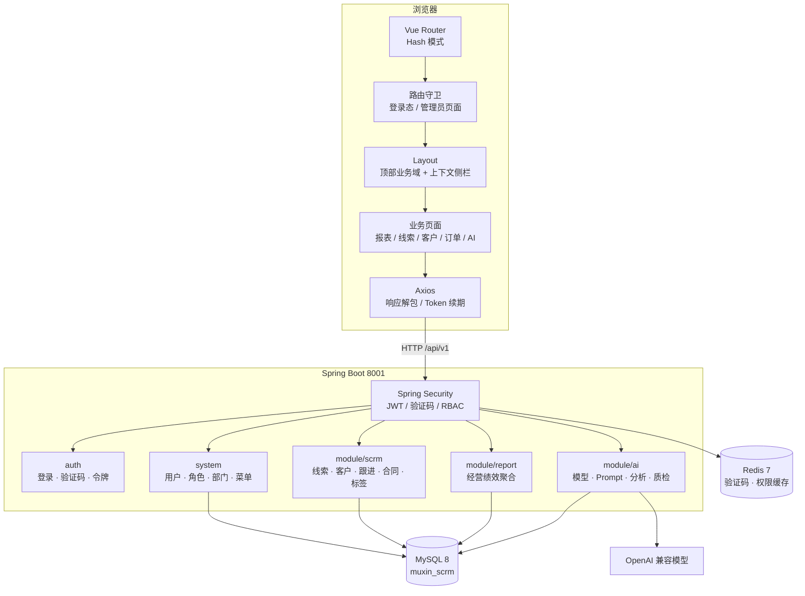
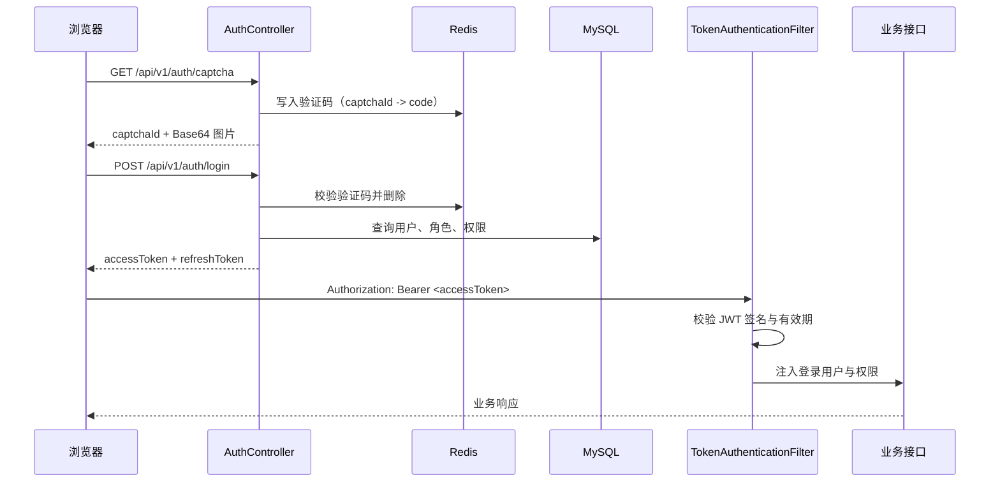
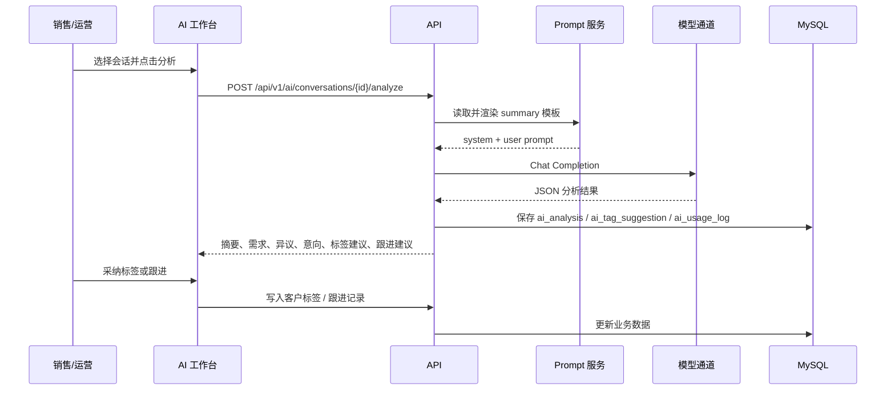
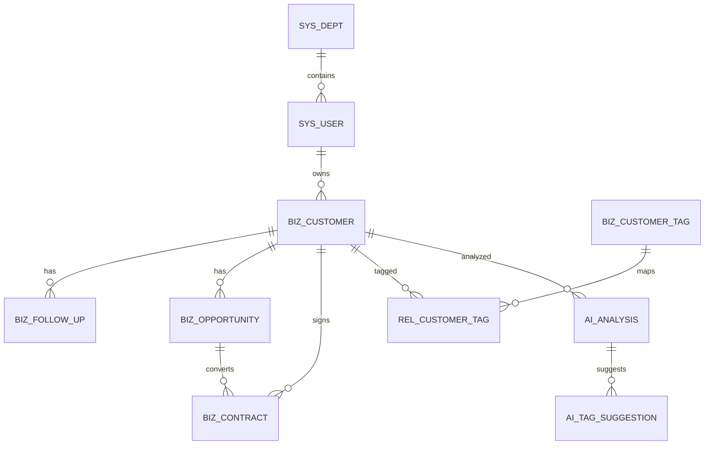

# 架构设计

本文说明 MUXIN AI SCRM 的模块边界、关键链路与实现取舍。项目定位见 [README](../README.md)，接口细节见 [API 说明](api.md)。

## 1. 设计目标

| 目标 | 落地方式 |
| --- | --- |
| 业务数据可运营 | 线索、客户、跟进、商机、合同、标签与报表构成私域数据底座 |
| AI 能力可治理 | 模型配置、Prompt 版本、调用日志、异步质检统一收敛到 `module/ai` |
| AI 结果可控 | 标签、跟进、质检结论均经过人工采纳或复核，不直接改写业务数据 |
| 前后端可独立演进 | Vue 3 SPA 与 Spring Boot API 通过 `/api/v1` 契约解耦 |
| 本地可复现 | Docker Compose 提供 MySQL 与 Redis，SQL 脚本自带演示数据 |
| 权限可收敛 | Spring Security + JWT + 权限点 + 数据范围 |

主要约束：

- 前端是纯静态 SPA，生产环境不依赖 Node 服务。
- 后端无状态认证（JWT），不依赖 HTTP Session。
- AI 供应商通过 OpenAI 兼容协议接入，不绑定单一厂商。
- 模型调用可能失败，因此提供确定性的 Mock 兜底，保证演示与联调可重复。

## 2. 总体架构



请求链路：

```text
开发：浏览器 -> http://localhost:3001
             -> /dev-api/**（Vite 代理去掉前缀）
             -> http://localhost:8001/**

生产：浏览器 -> https://<域名>/prod-api/**
             -> Nginx 去掉 /prod-api 前缀
             -> http://127.0.0.1:8001/**
```

前端 API 前缀由 `frontend/.env.development` 与 `frontend/.env.production` 中的 `VITE_API_BASE` 控制。

## 3. 后端结构

### 3.1 分层

```text
controller  -> 接收请求、参数校验、权限注解
service     -> 业务规则、事务、数据范围、AI 编排
mapper      -> MyBatis-Plus Mapper / 自定义 SQL
model       -> entity / form / query / vo
support     -> 数据范围、消息、文件、邮件等横切能力
```

统一返回 `Result<T>`：

```json
{ "code": "00000", "data": {}, "msg": "操作成功" }
```

分页返回 `PageResult<T>`，`data` 为 `{ "list": [], "total": 0 }`。

### 3.2 模块职责

| 模块 | 包路径 | 职责 |
| --- | --- | --- |
| 认证 | `com.muxin.scrm.auth` | 图形验证码、账号密码登录、短信登录、令牌刷新与退出 |
| 安全 | `com.muxin.scrm.security` | JWT 解析、登录用户、权限判断、未认证/无权限处理 |
| 系统 | `com.muxin.scrm.system` | 用户、角色、部门、菜单、字典、通知、日志 |
| 私域业务 | `com.muxin.scrm.module.scrm` | 客户、跟进、商机、合同、标签、营销活动、工作台 |
| 报表 | `com.muxin.scrm.module.report` | 员工绩效聚合查询 |
| AI 中台 | `com.muxin.scrm.module.ai` | 模型配置、Prompt、会话分析、标签与跟进建议、质检、用量 |
| 基础设施 | `com.muxin.scrm.common` / `core` / `config` / `support` | 响应体、异常、注解、Redis、邮件、文件、WebSocket |

`module/report` 刻意保持很小：只包含一个控制器和一个 VO，直接使用 `JdbcTemplate` 完成聚合查询，避免为单张报表引入实体与 Mapper。数据量增长后可替换为独立 Mapper 或预聚合表。

### 3.3 认证与权限



- 默认会话方式为 `jwt`，访问令牌 2 小时、刷新令牌 7 天，可由环境变量覆盖。
- 登录接口要求 JSON 请求体，并携带 `captchaId` 与 `captchaCode`。
- 后端使用 `@PreAuthorize("@ss.hasPerm('...')")` 做接口级权限校验；前端导航是静态的，因此「页面能打开」不等于「接口有权限」。
- 权限点来自 `sys_menu.perm`，经角色绑定后缓存在 Redis；`ROOT` 角色默认放行。
- `ScrmDataScope` 提供数据范围：`ADMIN`、`DEPT_MANAGER` 与超级管理员可查看全部，其他账号只看本人数据。

### 3.4 报表聚合

`GET /api/v1/reports/performance` 使用一条 SQL 完成聚合：

```text
sys_user (在职、未删除)
  LEFT JOIN sys_dept
  ├─ 客户数：biz_customer.owner_id = 用户，统计全部（不限日期）
  ├─ 跟进数：biz_follow_up.create_by = 用户，限定创建时间区间
  ├─ 订单数：biz_contract.owner_id = 用户，限定创建时间区间
  ├─ 订单金额：同一区间内合同金额求和
  └─ 赢单率：区间内 status = 3 的合同数 / 区间订单数
```

实现见 `backend/src/main/java/com/muxin/scrm/module/report/controller/PerformanceReportController.java`。

统计口径：

1. `customerCount` 是员工名下全部客户数，不是区间新增客户数。
2. 赢单率的分母是区间内新建订单数，跨期成交不会进入历史区间的分母。

## 4. AI 中台

### 4.1 组件边界

| 组件 | 职责 |
| --- | --- |
| `AiClient` | 模型调用抽象，屏蔽厂商差异 |
| `OpenAiCompatibleClient` | 通过 Chat Completions 协议接入兼容服务 |
| `MockAiClient` | 无 Key 或调用失败时的确定性兜底 |
| `AiModelConfigService` | 模型配置、默认模型、连通性测试、Key 加解密与脱敏 |
| `AiPromptTemplateService` | Prompt 读取、渲染与版本递增 |
| `AiConversationService` | 会话分析、标签建议、跟进建议与采纳写入 |
| `AiQualityRuleService` / 质检任务链路 | 规则维护、异步执行、结果落库与人工复核 |
| `AiUsageLog` | 功能、模型、耗时、Token 与调用结果 |

### 4.2 一次会话分析



### 4.3 智能质检

1. 管理员维护质检规则（规则内容、判定说明、严重级别）。
2. 业务人员选择会话与规则创建质检任务。
3. 异步执行器调用模型，逐条规则输出命中结论与证据原文。
4. 结果先进入 `ai_quality_result`，由人工标记「确认违规」或「误报」。
5. 概览统计只以复核后的结论为准。

当前执行器为进程内线程池，服务重启后不会恢复未完成任务；生产化应替换为持久化队列。

### 4.4 为什么 AI 结果不直接落业务表

模型输出存在不确定性，直接写客户标签或跟进记录会污染业务数据。因此项目采用 human-in-the-loop：

- 分析结果先进入 `ai_analysis`、`ai_tag_suggestion`；
- 销售确认后再写入客户标签；
- 跟进建议确认后才生成跟进记录；
- 质检结果必须经过复核才进入最终统计。

这让 AI 成为可审计的助手，而不是不可控的自动写入器。

## 5. 前端结构

```text
frontend/src/
├── layouts/index.vue          # 顶部业务域 + 上下文侧栏 + 公告 + 用户菜单
├── router/
│   ├── index.ts               # 静态路由、占位路由、404
│   └── guards.ts              # 登录态与管理员页面守卫
├── styles/theme.scss          # 主色、卡片、筛选栏等视觉令牌
├── navigation/
│   ├── menu.ts                # 导航结构（顶部区块 + 侧栏条目）
│   └── constants.ts           # 状态、来源、级别标签与格式化函数
├── api/
│   ├── analytics/index.ts     # 绩效、部门、用户、角色接口
│   ├── scrm/                  # 客户、标签、合同
│   └── ai/                    # AI 中台接口
└── views/
    ├── workspace/             # 线索、客户、订单、报表、组织、云店
    │   ├── lead/LeadList.vue
    │   ├── customer/CustomerList.vue
    │   ├── order/OrderList.vue
    │   ├── report/PerformancePage.vue
    │   ├── report/MeritsPage.vue
    │   ├── system/DeptPage.vue
    │   ├── system/RolePage.vue
    │   └── gateway/StorePage.vue
    ├── ai/                    # 工作台、质检、设置
    └── PlaceholderPage.vue    # 未实现导航的统一占位
```

### 5.1 路由模型

- 使用 `createWebHashHistory()`，静态托管无需服务端 rewrite。
- 业务路由在 `constantRoutes` 中静态声明，不依赖后端菜单下发。
- `/` 重定向到 `/report/performance`。
- 未匹配路由重定向到 `/404`。
- `/ai/settings` 需要管理员角色，守卫见 `router/guards.ts`。

### 5.2 导航模型

顶部七个业务域：线索管理、客户管理、订单管理、系统设置、统计报表、数据互通、AI 中台。

每个区块包含 `path`（点击区块时跳转）和 `items`（侧栏条目）。侧栏根据当前路径定位区块，条目激活规则支持子路径；`/crm/clues/create` 被视为一次性入口，不作为其他线索页的父级高亮。

导航数据集中在 `frontend/src/navigation/menu.ts`。新增页面时需要同时：

1. 在 `menu.ts` 增加条目；
2. 在 `router/index.ts` 增加路由；
3. 若为占位页，复用 `PlaceholderPage`。

### 5.3 数据访问

- Axios 实例自动附加 `Authorization`，并按业务码解包 `data`。
- 业务失败统一 `ElMessage` 提示并 reject，页面只处理成功分支。
- 401/令牌失效由续期拦截器处理，续期失败后清理状态并回到登录页。
- 后端将 `Long` 序列化为字符串，凡参与运算的 ID 或金额先 `Number(...)`。

### 5.4 页面模式

大多数业务页遵循同一结构：

```text
标题
筛选卡片（关键词 / 状态 / 日期 / 部门 / 员工 ...）
操作栏（新建、导出、批量操作）
表格 + 分页
表单对话框 / 详情抽屉
```

报表页在筛选区下方增加统计卡与图表；CSV 导出在前端生成 Blob，不经过后端。

## 6. 数据模型



### 6.1 业务表

| 表 | 说明 | 关键字段 |
| --- | --- | --- |
| `biz_customer` | 线索与客户共用一张表 | `status`、`level`、`source`、`owner_id`、`dept_id`、`is_deleted` |
| `biz_follow_up` | 跟进记录 | `customer_id`、`type`、`content`、`result`、`next_follow_time` |
| `biz_opportunity` | 商机 | `customer_id`、`stage`、`probability`、`amount`、`expected_close_date` |
| `biz_contract` | 合同（界面作为订单） | `contract_no`、`customer_id`、`amount`、`status`、`sign_date` |
| `biz_customer_tag` | 标签定义 | `name`、`color`、`sort` |
| `rel_customer_tag` | 客户与标签关联 | `customer_id`、`tag_id` |
| `biz_campaign` | 营销活动 | `type`、`channel`、`budget`、`status`、`lead_count` |

### 6.2 AI 表

| 表 | 说明 |
| --- | --- |
| `ai_model_config` | 模型配置、加密 Key、默认模型 |
| `ai_prompt_template` | 摘要/质检 Prompt 与版本 |
| `ai_analysis` | 会话分析结果 |
| `ai_tag_suggestion` | 标签建议与证据 |
| `ai_quality_rule` | 质检规则、判定说明、严重级别 |
| `ai_quality_task` | 质检任务与执行状态 |
| `ai_quality_result` | 命中结果、证据、复核结论 |
| `ai_usage_log` | 调用功能、模型、耗时、Token |

### 6.3 状态约定

客户状态：

| 值 | 含义 | 界面用途 |
| --- | --- | --- |
| 1 | 潜在客户 | 线索 |
| 2 | 跟进中 | 客户 |
| 3 | 已成交 | 客户 |
| 4 | 已流失 | 客户（历史状态） |

订单（合同）状态：`1 待审核`、`2 已确认`、`3 已完成`、`4 已取消`。

线索与客户列表通过 `statuses=1` 或 `statuses=2,3` 区分，后端把逗号分隔字符串解析为 `IN` 条件。

### 6.4 通用约定

- 所有业务表使用逻辑删除 `is_deleted`，MyBatis-Plus 自动追加条件。
- 审计字段为 `create_by`、`create_time`、`update_by`、`update_time`，由元对象处理器填充；显式更新场景（模型配置、Prompt、质检规则）在 Service 内写入 `updateTime`，避免 `strictUpdateFill` 保留旧值。
- 客户同时记录 `owner_id` 与 `dept_id`，便于按人/按部门过滤。
- 主键与金额在前端按字符串接收，展示与计算时转换。

## 7. 已知边界

- 导航是静态的，占位页不响应真实权限配置。
- 未实现企业微信回调、会话存档、多租户、审批流与消息中心。
- 数据范围只区分「全部」与「本人」，没有按部门树递归。
- 质检异步执行器未持久化，重启后不恢复任务。
- 业绩聚合未做缓存，数据量增大时需要索引或预聚合。
- 前端未引入端到端测试，关键流程依赖手工回归。

## 8. 可扩展方向

1. 接入企业微信自建应用：通讯录同步、客户联系、会话存档与回调。
2. 把静态导航改为后端菜单 + 权限过滤，保持 URL 不变。
3. 质检任务迁移到持久化队列，增加失败重试与死信处理。
4. 引入企业知识库与 RAG，让跟进建议引用内部资料。
5. 为报表增加部门维度和区间新增客户数。
6. 引入 Testcontainers + Playwright，覆盖登录、线索转化、订单审核、AI 采纳与报表导出。
